# 💫 About Me

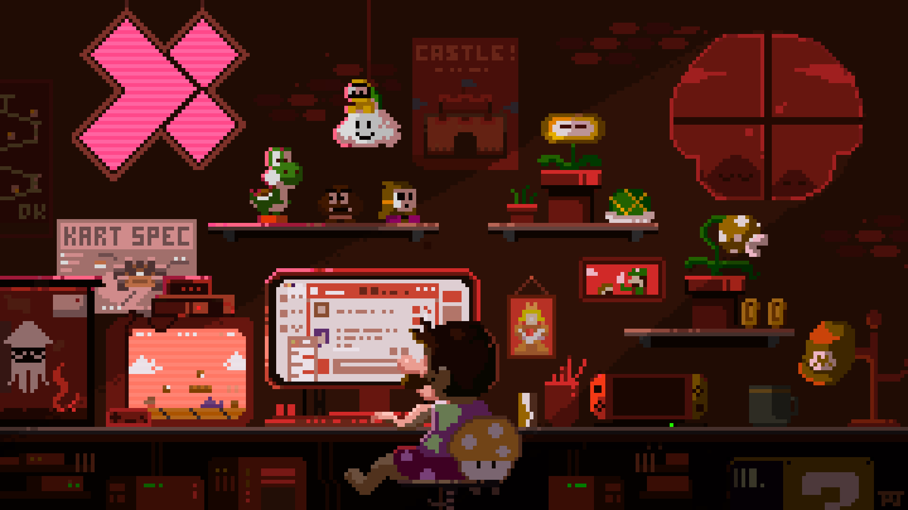

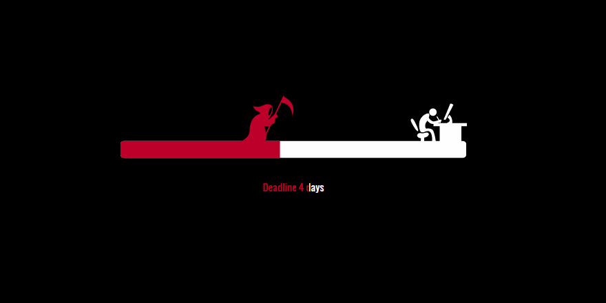

# 💻 Tech Stack

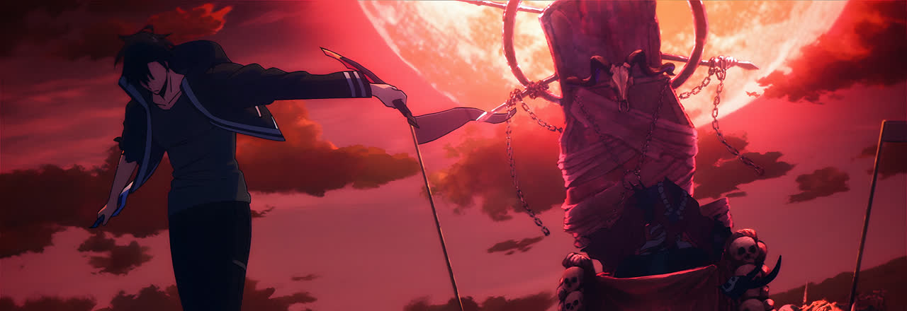

  

# 📊 GitHub Stats

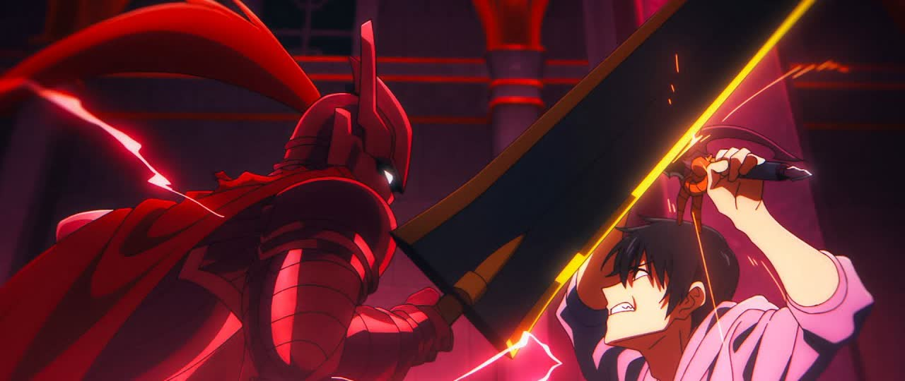




  

## 🏆 GitHub Trophies

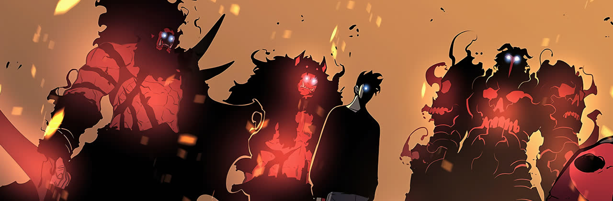


## ⚔️ S-Rank Missions

<table>
<tr><th>Mission</th><th>What it is</th><th>Built with</th><th align="center">⭐</th></tr>
<tr><td><a href="https://github.com/SUDARSHANCHAUDHARI/OrbiAgents"><b>OrbiAgents</b></a></td><td>Visual multi-agent workflow orchestration, execution, and replay — the largest codebase here, with 274 test files</td><td><code>TypeScript</code></td><td align="center"></td></tr>
<tr><td><a href="https://github.com/SUDARSHANCHAUDHARI/QACraft"><b>QACraft</b></a></td><td>Reusable QA skills and deterministic behaviour evaluations, with adapters for Codex, Claude Code, Copilot, and Gemini CLI</td><td><code>HTML</code></td><td align="center"></td></tr>
<tr><td><a href="https://github.com/SUDARSHANCHAUDHARI/RepoMem"><b>RepoMem</b></a></td><td>Persistent, local-first memory for AI coding agents using SQLite and FTS5, with zero dependencies</td><td><code>Python</code></td><td align="center"></td></tr>
<tr><td><a href="https://github.com/SUDARSHANCHAUDHARI/SaveMyTerminal"><b>SaveMyTerminal</b></a></td><td>Local, privacy-safe observability for terminal-based AI agents — published on crates.io</td><td><code>Rust</code></td><td align="center"></td></tr>
<tr><td><a href="https://github.com/SUDARSHANCHAUDHARI/TemporalThread"><b>TemporalThread</b></a></td><td>Local-first MCP server that gives AI agents a persistent sense of time, with no network port and no telemetry</td><td><code>TypeScript</code></td><td align="center"></td></tr>
<tr><td><a href="https://github.com/SUDARSHANCHAUDHARI/RepoGuardAI"><b>RepoGuardAI</b></a></td><td>Agent-independent security and code auditing with deterministic scanners and structured reports</td><td><code>JavaScript</code></td><td align="center"></td></tr>
<tr><td><a href="https://github.com/SUDARSHANCHAUDHARI/BarStripeLab"><b>BarStripeLab</b></a></td><td>Free in-browser barcode generator that shapes EAN, UPC and Code 128 codes while keeping them scannable — GS1 sizing, decode checks and exact-size SVG/PDF export (<a href="https://barstripelab.sudarshantechlabs.com">live</a>)</td><td><code>TypeScript</code></td><td align="center"></td></tr>
<tr><td><a href="https://mywindchimes.sudarshantechlabs.com"><b>MyWindChimes</b></a></td><td>Interactive wind chimes from seven Asian countries on handmade paper — photoreal chime tops, a physics-driven curtain of each country's script, crossfading journeys and procedural sound (<a href="https://mywindchimes.sudarshantechlabs.com">live</a>)</td><td><code>Web</code></td><td align="center">🌐</td></tr>
</table>

<a href="https://github.com/SUDARSHANCHAUDHARI?tab=repositories"><b>→ See all repositories</b></a>

  

### 🌃 My contribution village

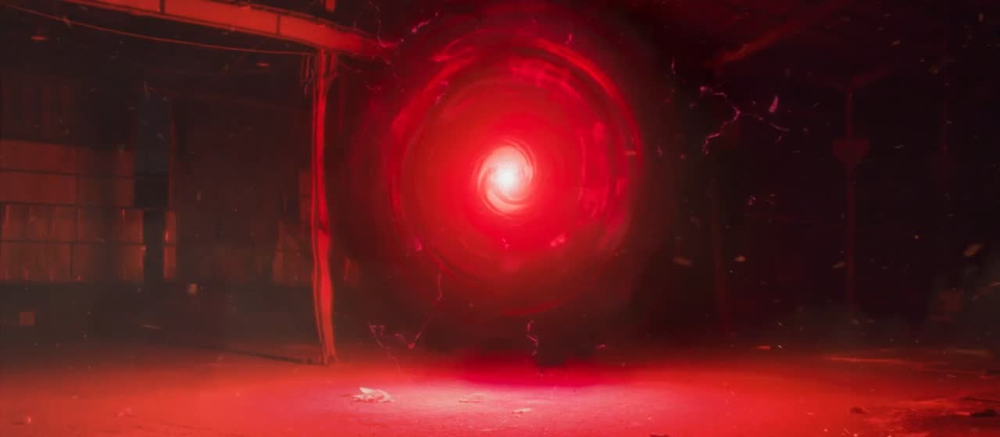

*Every commit raises another building — rebuilt automatically every day.*


  

<picture>
  <source media="(prefers-color-scheme: dark)" srcset="https://raw.githubusercontent.com/SUDARSHANCHAUDHARI/SUDARSHANCHAUDHARI/output/snake-dark.svg" />
  
</picture>

  

<a href="https://commit-history.com/SUDARSHANCHAUDHARI"></a>


## 🗺️ Dungeon Record

## 👤 Player Profile

### ✍️ Random Dev Quote

&nbsp;&nbsp;<b>Sudarshan's mood after coding for 5 minutes</b>

## 🌐 Socials

  

  

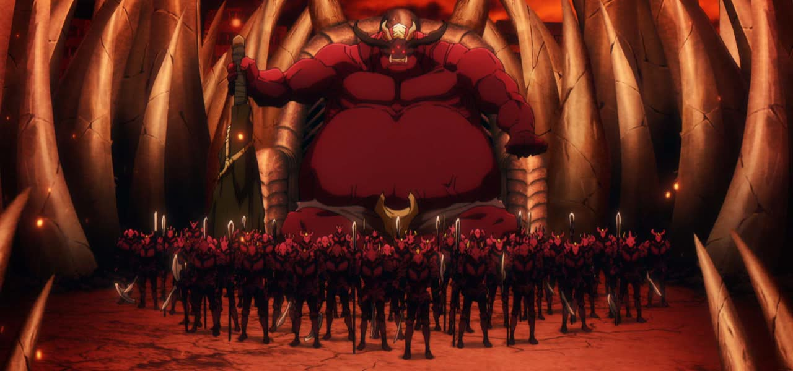

  

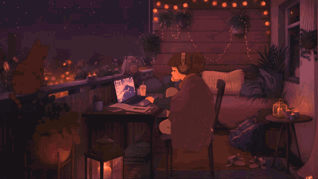

  

<h1>Build it, test it, ship it. 🚀</h1>

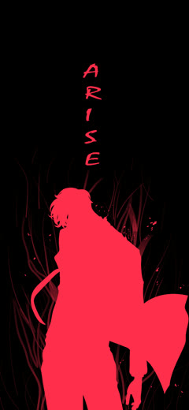

  

  

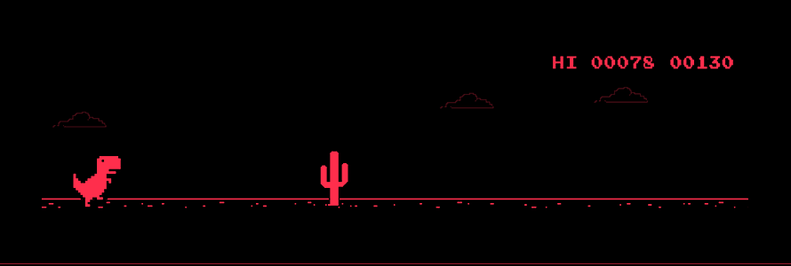

  

<h1><i>The System is watching.</i></h1>

